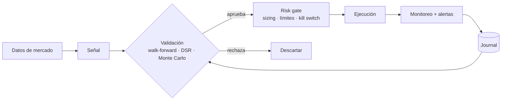

# Trading Bots Showcase

Arquitectura y decisiones de diseño de mis bots de trading algorítmico. **Solo diseño y documentación**: el código de las estrategias, parámetros, umbrales y configuraciones permanecen privados.

*Architecture and design notes for my algorithmic trading bots. Design and documentation only; strategies, parameters and thresholds are private.*

## Los bots

| Bot | Mercado | Stack | Idea central |
|---|---|---|---|
| **MT5 Runner** | Forex / oro (MetaTrader 5) | Python, FastAPI, Next.js | Ejecución en VPS con validación estadística antes de operar en vivo |
| **Solana Bot** | Memecoins / DEX (Solana) | TypeScript, Node.js | Filtros de calidad + simulación realista de costos (paper) antes de live |
| **Camello** | Cripto (paper) | Python 3.12 | LLM propone, modelo puntúa, núcleo determinista ejecuta |

## Principios comunes

1. **Paper primero.** Nada pasa a dinero real sin un checklist explícito y aprobación humana.
2. **Falla cerrada.** Ante datos dudosos, latencia o error, no se opera.
3. **Separación de capas.** Los modelos nunca controlan límites de riesgo ni órdenes.
4. **Validación anti-overfitting.** Walk-forward, Deflated Sharpe Ratio y Monte Carlo de drawdown — ver [strategy-robustness-kit](https://github.com/sergiogoqui-cpu/strategy-robustness-kit).
5. **Costos realistas.** Spread, slippage y comisiones se modelan en el backtest.
6. **Operación observable.** Alertas por Telegram, informes diarios y paridad vivo/backtest.
7. **Secretos fuera del repo.** Todo vía variables de entorno; `.gitignore` bloquea llaves y `.env`.

## Arquitectura por bot

Ver [`docs/architecture.md`](docs/architecture.md).

## Contacto

[LinkedIn](https://www.linkedin.com/in/sergio-gomez-9b68a6375/) · [@sergiogoqui-cpu](https://github.com/sergiogoqui-cpu)

> Proyecto educativo. No es asesoría financiera.
