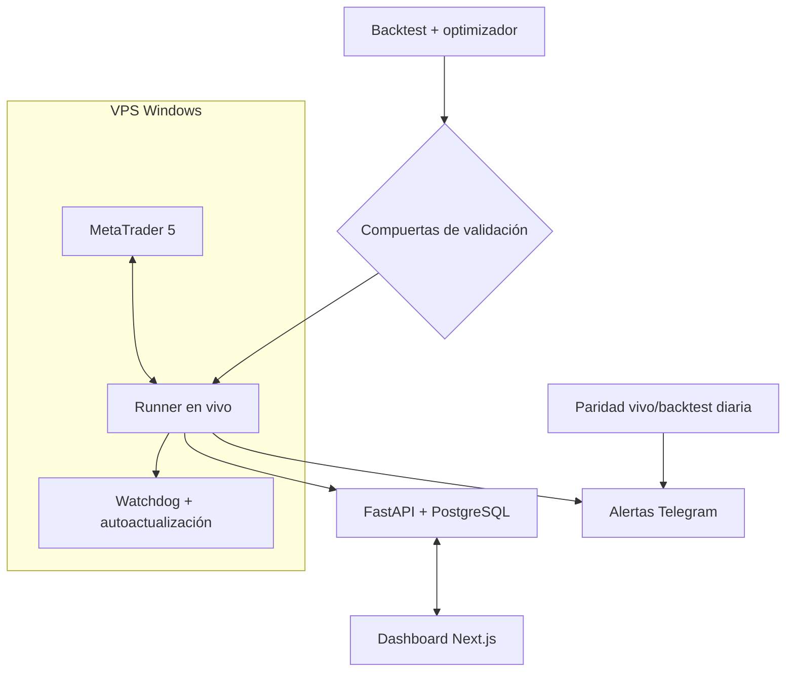
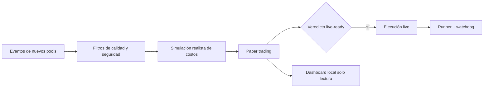
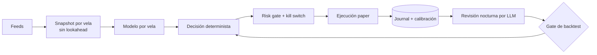

# Arquitectura

## MT5 Runner (forex / oro)

- Optimización y validación offline; el runner solo recibe configuraciones que pasaron todas las compuertas.
- Alarma diaria de paridad entre resultados en vivo y backtest para detectar deriva.

## Solana Bot (memecoins)

- Dashboard en `127.0.0.1`, solo lectura.
- Clave de wallet únicamente por entorno; nunca en logs ni en disco versionado.

## Camello (cripto, paper)

- El LLM nunca califica su propio backtest ni toca límites de riesgo.
- Test de fuga de datos y fills en la apertura de la vela siguiente.
