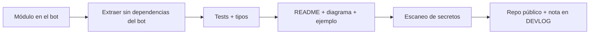

# Micro-herramientas open source (roadmap)

Utilidades genéricas extraídas de los bots. Cada una será un repo independiente, pequeño, con tests, CI, README con Mermaid y cero lógica de estrategia.

| # | Herramienta | Origen | Lenguaje | Qué resuelve |
|---|---|---|---|---|
| 1 | **ws-resilient** | Feed WebSocket con backoff, timeout de inactividad, heartbeat y detección de huecos en `trade_id` | Python | Cliente WebSocket que reconecta con backoff exponencial + jitter, detecta mensajes perdidos y marca cobertura de datos |
| 2 | **http-guard** | Cliente HTTP con timeouts, reintentos, manejo de 429 y circuit breaker por host | TypeScript | `fetch` resiliente para APIs con rate-limit, con ruta "crítica" que ignora el breaker |
| 3 | **safe-logger** | Logger con redacción automática de secretos y saneado de entradas hostiles | TypeScript / Python | Logs a disco que nunca filtran claves ni tokens |
| 4 | **backtest-metrics** | Retornos diarios, Sharpe, drawdown, calendario 24/7 | Python | Métricas puras y testeadas para cripto (365 días) |
| 5 | **mt5-data-fmt** | Utilidades de velas y trades de MetaTrader 5 | Python | Convertir datos de MT5 a DataFrame/Parquet con zona horaria correcta |
| 6 | **bot-telegram-alerts** | Alertas Telegram con deduplicación y límites de frecuencia | Python | Notificaciones de bots sin spam |

## Orden sugerido

1. `ws-resilient`: más buscado y más útil para cualquier bot de mercado.
2. `safe-logger`: resuelve un problema real de seguridad.
3. `backtest-metrics`: complementa a [strategy-robustness-kit](https://github.com/sergiogoqui-cpu/strategy-robustness-kit).

## Reglas de extracción

- Sin parámetros, umbrales, nombres de estrategias ni valores por defecto sacados de producción.
- Sin URLs de infraestructura propia, IPs, correos ni rutas locales.
- Cada repo: licencia MIT, `pytest`/`vitest`, CI en GitHub Actions, README con badges y diagrama, ejemplo ejecutable.
- Revisión previa a publicar: buscar secretos con `git grep` y `gitleaks`.

## Flujo por herramienta

